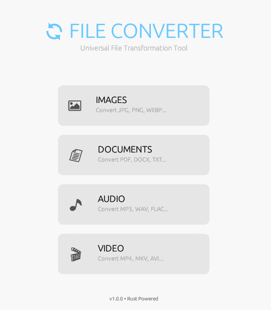

#  Rust File Converter

A fast, secure, and universal file converter, built with **Rust** featuring a modern graphical interface.




## Features

Bulk file conversion via a simple drag-and-drop or file selection interface.

### Images (Native - No dependencies)
Image conversion with quality control.
- **Supported formats:** `JPG`, `PNG`, `BMP`, `GIF`, `WEBP`, `ICO`

### Audio (Requires FFmpeg)
Audio conversion with bitrate selection.
- **Supported formats:** `MP3`, `WAV`, `OGG`, `FLAC`, `AAC`

### Video (Requires FFmpeg)
Video conversion with codec selection.
- **Supported formats:** `MP4`, `MKV`, `AVI`, `MOV`

### Documents (Requires Pandoc)
Text document conversion.
- **Supported formats:** `PDF`, `DOCX`, `TXT`

---

## System Requirements

For all features to work, you must install the following external tools on your system:

1.  **FFmpeg** (For Audio & Video)
    *   Download: [ffmpeg.org](https://ffmpeg.org/download.html)
    *   *Important:* Make sure to add `ffmpeg` to your system PATH environment variable.

2.  **Pandoc** (For Documents)
    *   Download: [pandoc.org](https://pandoc.org/installing.html)

> **Note:** The image converter works natively without installing these tools.

---

## Installation and Usage

1.  Clone the repository:
    ```bash
    git clone https://github.com/your-username/Rust-File-Converter.git
    cd Rust-File-Converter
    ```

2.  Run the application:
    ```bash
    cargo run --release
    ```

3.  (Optional) Build an optimized executable:
    ```bash
    cargo build --release
    ```
    The executable will be located in `target/release/file_converter.exe`.

Or

Run:
```bash
File_Converter_V1.0.0.exe
```

---

## Technologies Used

*   **Language:** [Rust](https://www.rust-lang.org/)
*   **Interface (GUI):** [eframe / egui](https://github.com/emilk/egui)
*   **Conversion Engines:**
    *   `image` (Rust Crate)
    *   `ffmpeg` (CLI Wrapper)
    *   `pandoc` (CLI Wrapper)

## License

Distributed under the MIT License. See `LICENSE` for more information.
